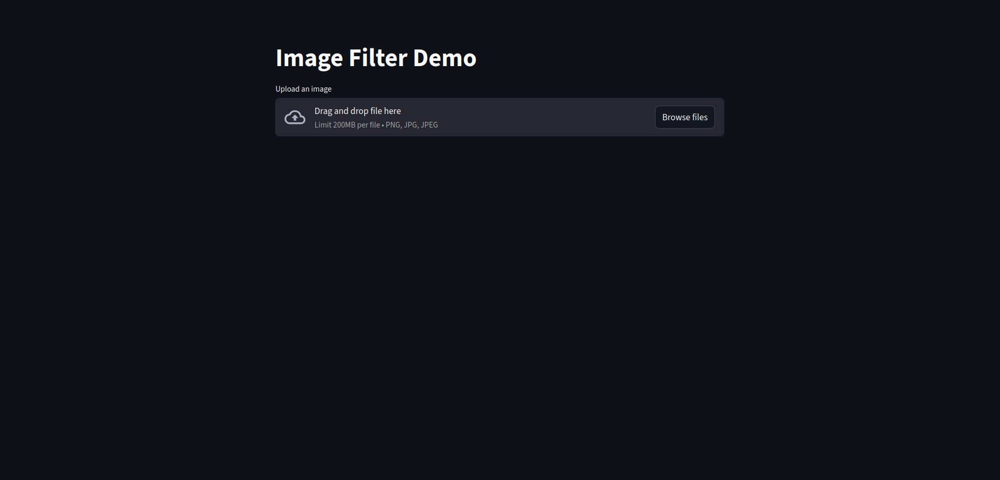
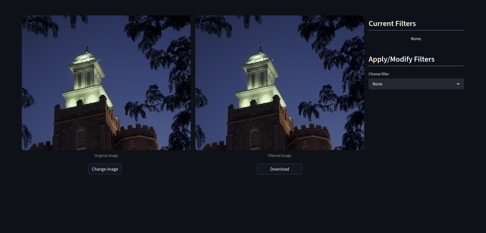
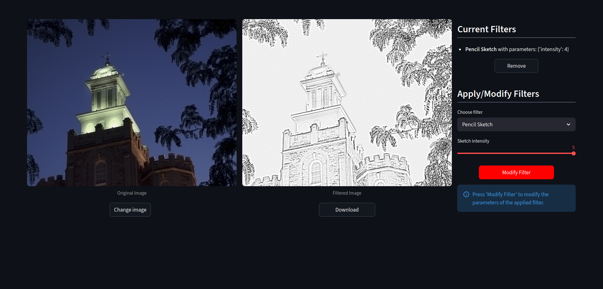
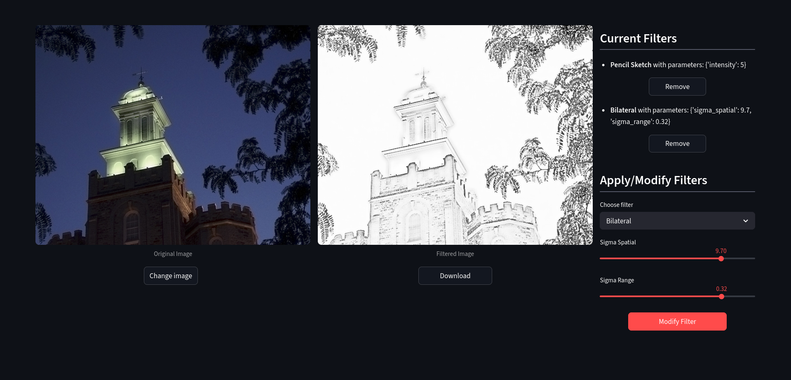

# Interactive Image Filtering Application

**University group project**
Python · Streamlit · OpenCV · NumPy · Pillow

An interactive image-filtering application built for a university image-processing course. Users can upload an image, combine and adjust filters, compare the original and processed results, and download the edited image.

## My Contributions

- **Application interface (`app.py`):** Responsible for developing the Streamlit UI and integrating the team's image filters, including image upload, side-by-side previews, filter controls, filter management, session state, and downloads.
- **Pencil Sketch filter (`filters.py`):** Implemented the pencil-sketch effect with adjustable intensity, including the image-processing operations behind it.
- **Integration:** Connected the separately developed filters into a single interactive workflow.

*This was a group project. The other image filters in `filters.py` were implemented by my teammates.*

## Preview
| | |
|:---:|:---:|
|  <br> **1. Image upload.** |  <br> **2. Filter selection.** |
|  <br> **3. Filter modification.** |  <br> **4. Applying multiple filters.** |

## Features

- Five image filters: Selective Colour, Cartoon, Bilateral, Vintage Film, and Pencil Sketch.
- Adjustable filter parameters and support for combining multiple filters.
- Ability to modify or remove applied filters without altering the original image.
- Exporting filtered images as PNG files.

## Running Locally

With Python installed, place `app.py` and `filters.py` in the same directory, then run:

```bash
pip install streamlit pillow numpy opencv-python
streamlit run app.py
```

The application opens in your browser.

## Project Context

This was an educational prototype rather than a production application. Some image-processing operations were implemented manually as part of the coursework, so processing large images may be slow. The app is presented through screenshots rather than a hosted demo.
